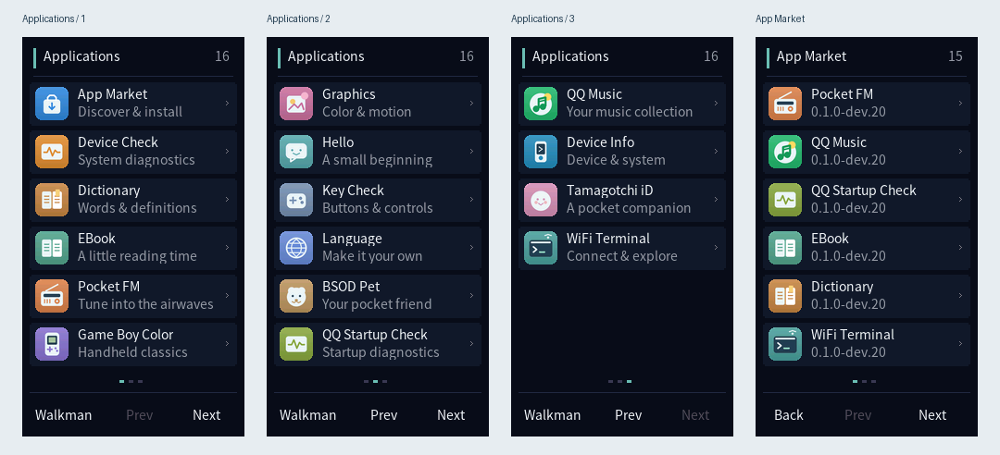
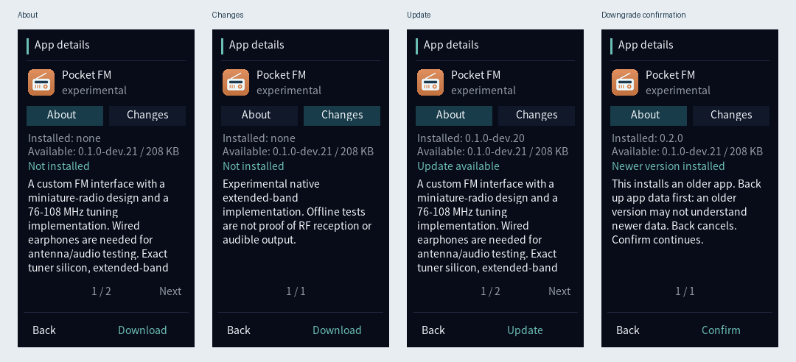
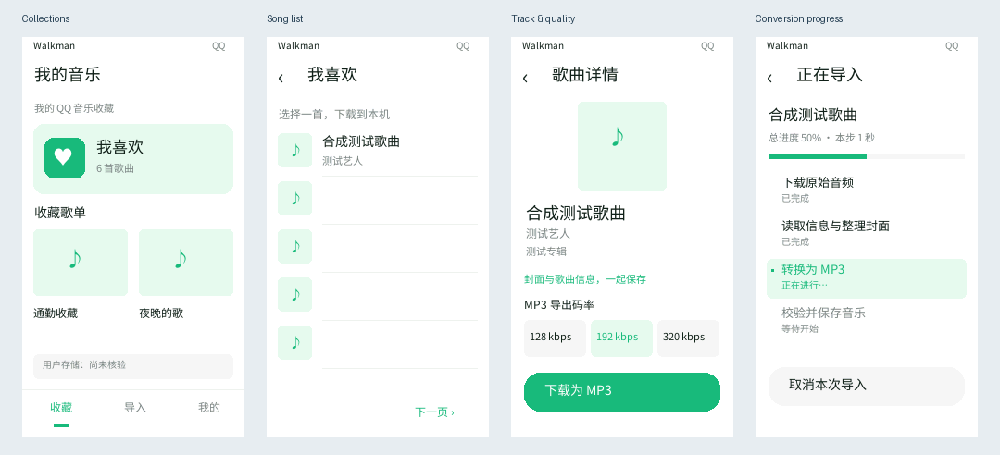
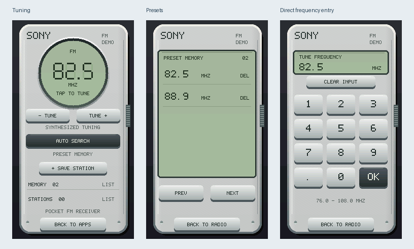
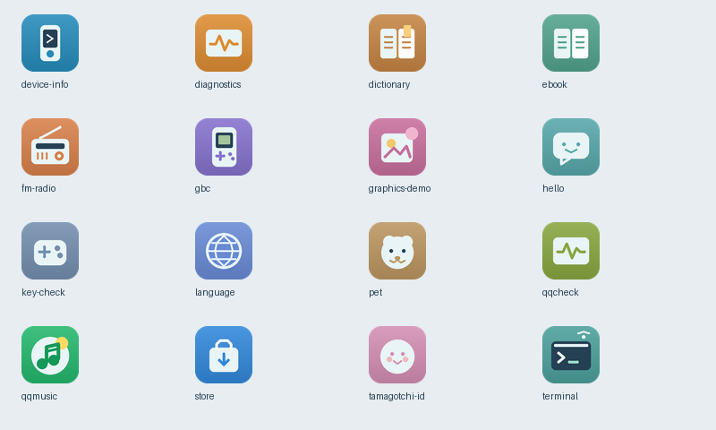

# Sony NW-X1000 Series Firmware Research

Native homebrew, localization and firmware research for the **Japanese Sony
NW-X1050 and NW-X1060**. The physical test unit is an NW-X1060 on the Japanese
1.11 platform. International NWZ-X images are comparison inputs, not interchangeable
installation packages. Device additions use C/C++ and necessary ARM assembly;
Python runs only on the development computer.

[Releases](https://github.com/vicliu624/sony-nw-x1000-series-cfw/releases) ·
[Build guide](docs/BUILD.md) · [Application guides](#applications) ·
[Validation status](docs/STATUS.md)

## Launcher and app market

One Homebrew entry opens a native launcher with individual color icons, readable
application cards and touch paging. Apps live on visible user storage.
The market shows app descriptions, changes, installed/available versions and
explicit install, update, reinstall or downgrade actions.

Details are shown before package payload download. Downloads and installation
have separate confirmations; downgrade has an additional warning. SemVer and
verified package identities prevent ambiguous equal-version replacements.

These are program-rendered previews with example versions and package fixtures,
not photographs of a physical player. Read the [market guide](docs/apps/STORE.md)
for source-snapshot selection, recovery and hardware-validation boundaries.

## QQ Music

Native QR login, account collections, song/album artwork, authorized source
downloads and tagged MP3 conversion/import are implemented. The interface includes
quality presets, download/conversion progress, cancellation and retry. Wi-Fi
preparation and explicit session-only clock handling are integrated.

The screens above come from the actual ARM UI renderer using synthetic account,
song and import states. Feature implementation is complete; continuous real-account
download, device conversion, Sony recognition and playback still need hardware
acceptance. See the [QQ Music guide](docs/apps/QQ_MUSIC.md).

## Pocket FM

A miniature-radio interface with tuning, presets and direct frequency entry.
The custom implementation covers 76-108 MHz without replacing Sony's FM program.

These are native-rendered fixture screens. They do not prove reception or audible
output across the extended band; see the [FM guide](docs/apps/FM_RADIO.md).

Application icon gallery

All fourteen release applications, BSOD Pet and the QQ startup diagnostic have
individual artwork. Unknown application IDs receive a generic fallback icon.

Only selected, credential-free previews are tracked under docs/images. Their
[provenance and regeneration guide](docs/images/README.md) separates rendered
software states from physical-device evidence; private photographs and session
material remain excluded.

## Documentation

- [Current status and validation limits](docs/STATUS.md)
- [Platform knowledge and research handoff](docs/KNOWLEDGE.md)
- [Physical hardware observations](docs/HARDWARE.md)
- [Build environment and commands](docs/BUILD.md)
- [CI, release packages and the application repository](docs/RELEASES.md)
- [Architecture and layout](docs/ARCHITECTURE.md)
- [Application development](docs/APP_DEVELOPMENT.md)
- [Application specification](docs/APP_SPEC.md)
- [Packages and storage rules](docs/APP_PACKAGES.md)
- [Localization and sleep incident](docs/LOCALIZATION.md)
- [System footprint](docs/SYSTEM_FOOTPRINT.md)
- [Third-party notices](THIRD_PARTY.md)

## Applications

| Application | Source | Guide |
| --- | --- | --- |
| WiFi Terminal | runtime/apps/terminal | [Terminal](docs/apps/TERMINAL.md) |
| Pocket FM | runtime/apps/fm-radio | [FM](docs/apps/FM_RADIO.md) |
| QQ Music | runtime/apps/qqmusic | [QQ Music](docs/apps/QQ_MUSIC.md) |
| QQ Startup Check | runtime/apps/qqcheck | [QQ Music](docs/apps/QQ_MUSIC.md) |
| Device Info | runtime/apps/device-info | [Device Info](docs/apps/DEVICE_INFO.md) |
| EBook | runtime/apps/ebook | [EBook](docs/apps/EBOOK.md) |
| Dictionary | runtime/apps/dictionary | [Dictionary](docs/apps/DICTIONARY.md) |
| Game Boy Color | runtime/apps/gbc | [Emulators](docs/apps/EMULATORS.md) |
| Tamagotchi iD | runtime/apps/tamagotchi-id | [Emulators](docs/apps/EMULATORS.md) |
| Language | runtime/apps/language | [Localization](docs/LOCALIZATION.md) |
| BSOD Pet | runtime/apps/pet | [Companion](docs/apps/PET.md) |
| Diagnostics / graphics / keys / hello | Separate runtime/apps folders | [Examples](docs/apps/DIAGNOSTICS.md) |
| Launcher / store | runtime/native, runtime/apps/store | [Store/runtime](docs/apps/STORE.md) |

Each application folder owns its code, app.json, VERSION, artwork and build
entry. Discover apps with `python tools/build_app.py --list`, then build one with
`python tools/build_app.py device-info --output work/my-device-info`. See the
[application specification](docs/APP_SPEC.md) for the complete contract.

One Sony Home entry opens the external launcher. Apps, resources and app data live
on visible user storage; app installation should not reflash the system.

## Evidence and local files

The terminal has executed authenticated commands on the physical player. This
does not qualify all apps, RF reception, sound, USB/sleep handoff or recovery.
Candidate 11 had an intermittent sleep incident; candidate 12's cache change has
not established physical sleep stability. QQ Music's complete real-account
download/import/playback chain and FM extended-band audio remain unverified.

The repository is hosted at https://github.com/vicliu624/sony-nw-x1000-series-cfw.
The Git boundary excludes `.tmp/`, `work/`, `firmware/`,
`dist/` and `bundles/`. Do not force-add their contents.

Old experiment logs/design previews are preserved in `.tmp/history/docs/`, and
superseded source snapshots in `.tmp/history/archive/`. Their hashes describe
their original state. Reusable build inputs and rollback evidence remain in
`work/` and `firmware/`; they were not deleted as disposable files.

Keep maintainable English documentation in `docs/`. Multilingual translations,
dictionary content and reader samples are product data. Never commit proprietary
Sony files, private keys, connection codes, account material, music, ROMs or saves.
Retain upstream notices and provenance.
