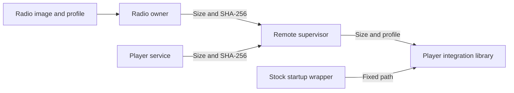

# Architecture

This project extends Sony's Japanese 1.11 Linux userspace. Sony retains kernel,
initrd, system startup, device drivers, playback engine and firmware installation.
A small native integration layer adds menu entries and system services; external
applications use the SDK and store their code/data on verified user storage.

## Responsibilities and dependencies

| Layer | Location | Owns | Must not own |
| --- | --- | --- | --- |
| Application | `runtime/apps/<id>/` | App behavior, UI, metadata, icon, version and app state | Global radio policy, stock memory addresses, another app's lifecycle |
| Public SDK | `sdk/include/x1000/`, `runtime/platform/sdk/` | App-facing contracts, capability checks, lifecycle and portable adapters | Sony menu business rules or application-specific radio packets |
| Service lifecycle | `runtime/platform/services/` | Capability descriptors, generations, request/event correlation and verified closure | Radio frame formats, Sony addresses or application UI policy |
| Player integration | `runtime/platform/player/` | Verified stock bindings, owner-loop dispatch, player service and stock lifecycle adapters | ESP-NOW packet semantics or remote UI |
| Private Sony Settings | `runtime/platform/sony-settings/` | Stock menu callbacks, verified view layout and wording access | Public SDK exports, pairing policy or radio ownership |
| Wireless platform | `runtime/platform/wireless/`, `runtime/platform/espnow/` | Radio policy, driver adaptation, permissions and verified retirement | Playback policy, album UI or an app-created global authority |
| Launcher/native adapters | `runtime/native/` | Discovery, process lifecycle, display/touch and stock ABI adaptation | Per-app implementation or unverified storage fallback |
| Shared storage/network | `runtime/store/` | Package IO, mount checks, libc/stat/time bridges, TLS and networking adapters | System-partition persistence or application account ownership |
| PC tooling | `tools/`, `scripts/` | Builds, analysis, packaging and offline checks | Device startup dependencies or automatic live tests |

A builder selects implementations and connects them. It must not decide runtime
business behavior. A protocol decoder validates messages; it does not power a
chip or mutate stock player state. A renderer displays state; it does not infer
that an accepted command has completed.

Closing a capability stops new work before releasing individual resources.
The player broker retains a failed or pending cleanup context without admitting
commands, reads or attachments. Cleanup completion and a new binding are separate
steps; a transient close result never silently reopens admission.
Native continuation validity controls forwarding, independently of cleanup
ownership. Revoking a native request must not abandon already-authorized
retirement or leave a callable continuation in a drain-only operation.

The existing player/radio integration contains private cross-layer adapters.
These are not public SDK promises. Before extracting another interface, identify
its owner, actual callers, state transitions and failure/cleanup behavior.
A forwarding wrapper alone does not establish a useful abstraction.

## Current coupling and required boundaries

Directory separation does not establish independent contracts. The current
implementation has the following confirmed coupling points:

| Coupling | Current evidence | Required boundary |
| --- | --- | --- |
| SDK compatibility | App definitions select callback or native module API versions. Module dependencies check their own required APIs. Builds record the exact SDK release and source hashes | Change the API version when its interface breaks. An SDK release bump alone requires no changes to app definitions that use compatible interfaces |
| Player composition | Built-in and external language profiles use maintained builder functions. Tests call the same functions, then verify the mapped edits independently | Keep production validation with the builder and test execution with the selected verification entry point |
| Compiled component identity cascade | The owner checks the selected radio image. The supervisor verifies owner and service sizes and hashes. The player library checks the supervisor's compiled size. The startup wrapper uses fixed paths | Reuse independently verified build inputs where their compile inputs match. Preserve runtime file checks until their replacement is verified at the same launch boundary |
| Incomplete startup error contract | `rf_owner.c:owner_prepare` reduces backend setup errors to `-1`; service startup reports a numeric result and a post-cleanup flag | Retain component, operation, result domain and original error. Readiness, failure and resource retirement are separate observations |
| Diagnostic records lack attempt identity | `parent_trace_store.c` fills a preallocated slot only once; `read_remote_pairing_trace.py` has no firmware/build or boot identity to validate | Use bounded, versioned records correlated to a build, boot and start request. Reading diagnostics must not depend on manually copying an empty file before each attempt |
| Historical local paths in supported tooling | The script audit found fixed review/candidate paths in maintained scripts and separate local orchestration files | Maintained entry points accept current input descriptors. Historical negative controls are explicit test inputs; ignored scripts and prior candidate directories are outside the normal build graph |

The host receipt records its compile contract separately from the exact
supervisor and radio identities selected by layout assembly. A new supervisor
and matching radio review can reuse a checked host when the supervisor size and
feature contract agree. Layout receipts bind the actual deployed executables,
radio image and selected reviews. Older host receipts retain their original
deployment pairing.

The build and runtime dependencies differ. The startup wrapper is rebuilt by
layout assembly. It carries the player library's path and can use the same
bytes whenever its own build inputs match. It carries no child hash or size.



The target dependency direction is platform adapters, capability services, SDK
contracts, then consumers. Wireless Remote consumes the radio and player
capabilities independently. Its Settings policy and remote protocol remain with
that consumer. Private Sony composition connects these pieces at one integration
boundary; it does not become another public service API.

The Remote consumer legitimately requires both capabilities. A failed dependency
must produce a specific startup failure and verified cleanup. A transport
experiment remains outside the ordinary delivery profile until its actual
startup, controls and retirement are qualified. Compiler success or an isolated
packet replay cannot select that profile for a working release.

Player result codes are a separate domain: `XW_PLAYER_IO` is -6 and
`XW_PLAYER_CLOSED` is -7. A service's post-cleanup flag describes its final
resource state, not the reason HELLO failed. Record CRC proves byte integrity;
build/boot/request identity must separately prove which attempt was captured.

Migration is incremental:

1. Remove build-to-test and test-to-test execution dependencies. Preserve generated
   bytes and existing component contracts while moving construction into normal
   maintained functions. No revision-specific replacement scripts are introduced.
2. Separate compatibility and package identities at their owning
   boundaries. Keep one original radio authority and preserve generation/retirement
   rules. Review each affected caller before changing an interface.
3. Archive obsolete orchestration only after the supported graph no longer refers
   to it. Preserve original inputs, usable rollback packages and minimal failure
   evidence. A directory move alone does not complete a boundary.

Runtime regression investigation remains separate from this sequence. Records
without build/attempt identity are historical observations. Obtain a correlated
failure before changing runtime startup behavior.

This is the architecture contract and migration order. These boundaries have not
all been implemented, and runtime bug fixing does not resume on the strength of
this document alone.

Private Sony menu adapters live in `runtime/platform/sony-settings/`. The Remote
consumer's `native_page_bridge` translates those private requests to its backend;
`settings_factory` coordinates that consumer's player/radio tasks. Neither is a
third-party app example or an SDK authority provider. Stock object layout and
menu constants belong in the platform adapter, not in the consumer's policy.

## Developer delivery gaps

The table above defines responsibilities, not a completed separation of the
current implementation. The checkout is a research platform with a usable
foreground callback API and experimental low-level services. It is not yet a
complete managed application platform.

The current source has these concrete dependencies:

| Module | Implementation that still crosses the intended seam | Required change |
| --- | --- | --- |
| Remote task composition | `runtime/apps/wireless-remote/settings_factory*`, `native_page_bridge*` | Consumer-specific integration with the private player owner remains distinct from a general app task manager |

The public SDK service implementation/header graph has no application source
dependency. `tests/test_sdk_shared_dependencies.py` checks the manifest and quoted
header closure. Private Sony Settings integration remains separate from that
claim; it is not an exported third-party application interface.

The Remote RF entry lives in `runtime/apps/wireless-remote/rf_owner.c`; the finite
diagnostic entry stays in `runtime/apps/espnow-test/main.c`. Both compose the
private `espnow/native_environment` module through `native_entry.h`, with explicit
reviewed manifest values. They do not include another executable. The module
owns file/mount qualification, data-directory opening and security preparation;
the caller retains its security workspace and closes it after radio retirement.
Pairing, admission, signals and exit policy remain with the composing entry.
These checks do not provide global USB/APF/radio authority and are not a public
SDK persistence or managed-task interface. Legacy standalone radio experiments
retain their separate source and evidence.

The `system-info` module lives in `runtime/platform/system-info/`. It owns bounded
read-only diagnostic collection and the legacy stock-statfs adapter. Device Info
owns its screen layout, touch loop and refresh policy. Its existing C structs and
text-page projection remain compatible; this is not a new structured telemetry
API or a firmware-capacity admission check.

The `volume` module lives in `runtime/platform/storage/`. It provides read-only
mount/descriptor observation and conservative space preflight to both callback
and native-service clients. QQ account/import policy remains in the app. Existing
`qq_*` source interfaces and plan categories are retained for compatibility;
moving them does not provide a general transaction API or USB ownership.

The `images` module lives in `runtime/platform/images/`. It owns bounded
in-memory decoding and format conversion. QQ artwork acquisition, account,
identity and cache policy remain application-local. Existing C names are retained;
callers serialize decoder use and supply nonoverlapping buffers.

Text assets live in `runtime/platform/text/`: `bitmap-font` provides glyph work
without query code; `lexicon` provides bounded read-only dictionary data access.
`unicode-font` is a legacy aggregate of the two. App-specific input and UI remain
in Dictionary, while EBook selects only `bitmap-font`. Compatibility declarations
do not register an input service or grant filesystem/display ownership.

The `audio-route` implementation lives in `runtime/platform/audio/`; receiver
models, tuner/session adapters and native FM transport live in `runtime/platform/fm/`.
They preserve the existing caller-owned resources and restoration contracts.
Pocket FM owns its presentation, preferences and storage. Moving the shared
code does not establish a native Sony audio handoff or physical RF/audio acceptance.

The callback runtime also has a deliberate delivery limit: its device storage
provider defaults to unknown ownership and denies persistent IO. A third-party
app cannot solve this by installing an always-successful callback. Qualified
ownership must be supplied by platform integration. Likewise, a managed player
client can consume a supplied grant; it is not a general app task manager.

Developer delivery requires all of the following:

- A new app can be created, previewed and packaged from the documented SDK
  without editing the launcher, service implementation or firmware composition.
- Its declared modules identify the capabilities it actually uses. The public
  interface explains acquisition, stop, pending cleanup, failure and reuse; it
  does not require knowledge of Sony addresses or private Settings callbacks.
- Assets and app policy remain with the app. Shared SDK implementation does not
  depend on another app's business implementation or build recipe.
- Required capabilities are available in the advertised runtime profile. An
  unavailable persistence or service grant is reported before a developer builds
  a workflow around it, rather than hidden behind a successful preview.
- Fresh SDK extraction exercises the documented examples and package inventory.
  Caller-level tests cover failure and cancellation as well as helper functions.
- The exact final composition has separate physical acceptance for startup,
  application return, Wi-Fi handoff, sleep/wake, USB and affected RF/audio paths.

General delivery remains unqualified. Local supervised-test candidates have
their own immutable receipts; they do not establish a public release or physical
acceptance of the current source tree.

## Original application switching

Sony Home selects the Homebrew entry. The original manager launches its proxy
through appproxy. The launcher discovers external packages, releases its own
resources and starts one child. Applications are not individually registered
in the original Home menu.

The player owner loop performs stock transitions. CFW may defer completion until
its own consumers have stopped; it must not call stock transitions recursively
from the intercepted action or synthesize completion from an elapsed timeout.

Native continuation validity and owned-resource cleanup are separate contracts.
Once an authorized drain starts, revoking its native continuation still retires
SDK sessions, reader threads and its independent dependency. The old continuation
remains permanently rejected, including after its input view becomes valid again.
Confirmed generation retirement does not reopen admission. A later original exit
request needs fresh owner, code, Root identity and radio checks; it cannot revive
the revoked callback or clear the player's exit flag. A genuine cleanup failure
retains fault handling and supplies no retirement proof.

The SDK drain can finish before an independent retirement callback. A new
qualified native exit may adopt that completed drain while the host remains
STOPPING. It must still check its native context and poll its own epoch-scoped
dependency; it cannot restart SDK closure, substitute the SDK generation for
that epoch or treat a retained/faulted broker as completed cleanup.

The native continuation has a separate read-only resource query. It accepts the
matched, fully drained CALLING state inside owner dispatch and successful DONE
after dispatch. This lets the exit bridge record delegation and handle a later
original exit request. Ordinary SDK operations remain blocked during dispatch
and closed after exit; revoked/faulted preparation supplies no successful-native
proof. Root, image, owner and radio checks still qualify every delegated request.
The coordinator call retains the preparation bridge's busy guard. A request
inside that call is held; a later qualified request after return may delegate.

Owner-side asynchronous work is integrated through the qualified original input
wait, not a background polling loop. The [wait-source table](reference/STOCK_LIFECYCLE.md#original-input-wait)
identifies the current session, mode, pairing-result and native wireless channels
and their cleanup lifetimes. A one-shot startup offer is a separate profile and
does not turn the system player into an app-discovery listener.

The dev.32 Homebrew entry uses mode1/command3 and follows the shutdown path.
The retained mode0/command6 profile preserves the native process and Wi-Fi lease.
The user reports fast Homebrew entry/exit and Wi-Fi continuity on the private
`native-ipc-01` diagnostic. That report covers the observed handoff; current app
launch, sleep/wake, Remote and USB acceptance remain scoped in [status](STATUS.md).

| Transition | CFW action | Native Wi-Fi |
| --- | --- | --- |
| Retained application handoff, command6 | Stop player-dependent consumers; close their SDK generation; forward the original coordinator | Keep the current verified native lease/connection |
| Homebrew to player | Wait for successful stock activation and newer sequence; reopen player admission | Reuse the surviving native lease |
| Sleep preparation | Stop custom consumers and verify radio retirement before acknowledgement | Follow the qualified sleep retirement path |
| Command3, including deployed mode1 Homebrew and USB/permanent exit | Drain consumers and require verified stop | Follow Sony shutdown and ownership transfer |

`host_handoff_bridge.c` owns the application transition state machine.
`sleep_host.c`/`sleep_native.c` own sleep preparation and recovery.
`host_prepare_bridge.c` owns permanent preparation. These call distinct private
wireless methods; one generic "release everything" callback is insufficient.

An application switch whose captured native view changes still owns its pending
radio/SDK drain. It finishes that cleanup without forwarding the cancelled
command6 or accepting its command7 return. A later matching view cannot revive
the old continuation. Confirmed cleanup retires the held view; a cleanup error
retains fault handling and is not treated as successful cancellation.

## Radio capability and remote player policy

The serialized system owner is the only radio authority. Native Wi-Fi owns the
stock connection. A shared ESP-NOW consumer receives a scoped borrow and cannot
release that native lease. A borrowed ticket and its generation prevent a late
consumer from releasing a newer session.

Wireless Remote combines two separately acquired capabilities: ESP-NOW transport
and original-player control. Leaving the player retires this consumer. Other
homebrew apps may use the transport without acquiring player control. The
public SDK's published capability set must be distinguished from the private
system integration; see [wireless](sdk/WIRELESS.md).

RF cleanup is complete only after the responsible owner supplies matching
retirement evidence. A process exit, UI return, sleep flag or closed descriptor
alone is not that evidence. Failure retains ownership for cleanup rather than
creating a second authority.

## State and storage

- Each app owns its `VERSION`, metadata, icon and app-local resources.
- Program/data persistence uses the verified exposed user volume, with device,
  mount, symlink, space and USB ownership checks. There is no system fallback.
- Player snapshots, UI projections and transfer buffers are bounded RAM state.
  Cached metadata must be distinguished from fresh observation.
- An observation can be temporarily unavailable without revoking its service.
  Image clients pause on unknown track identity; each managed READ grant binds
  a cache epoch before accepting later chunks. Presentation consumes const
  progress and an image-ready result instead of editing transfer state.
- Binding keys and monotonic packet counters survive service and firmware
  updates. Never reset a counter under an existing key to bypass a failure.
- Sony fixed addresses, event IDs and object offsets belong in private platform
  adapters with image checks and named meanings. Applications consume typed
  results instead of reading those addresses.

## Repository layout

```text
runtime/apps/       Per-app behavior, version, metadata and assets
runtime/native/     Launcher, process and device ABI adapters
runtime/platform/   Shared SDK and verified native service adapters
runtime/store/      Package, storage, libc and network bridges
sdk/                Public C/C++ headers, examples and SDK metadata
tools/, scripts/    PC tooling and offline verification
config/             Build/package composition
translations/       Multilingual product data
assets/             Shared artwork inputs
sources/            Provenance and pinned input metadata
third_party/        Upstream source and licenses
docs/               Current English contracts and technical reference
work/               Ignored reusable inputs and generated test results
.tmp/               Ignored private evidence, scratch and superseded notes
firmware/, dist/    Ignored proprietary inputs and local delivery outputs
```

Do not copy trail-mate's hardware layers into this platform. Its relevant design
principle is explicit ownership: platform adapters implement capabilities,
application policy consumes them, presentation displays results, and composition
connects them. Sony's verified ABI and original lifecycle remain this project's
platform constraints.

See [development](APP_DEVELOPMENT.md), [SDK](sdk/README.md),
[wireless](sdk/WIRELESS.md) and [regression checks](REGRESSION.md).
