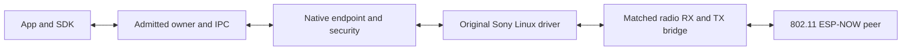

# ESP-NOW implementation

The Japanese X1000 transport reuses Sony's original Linux Wi-Fi driver and the
SD8686 radio's management-frame machinery. Native C/C++ owns bounded host IPC,
packet handling and lifecycle; a matched Thumb payload runs on the separate
radio CPU. It is not an Espressif SDK port, replacement Linux driver or SDR.
For app code use [SDK ESP-NOW services](sdk/ESPNOW.md). For exact endpoint and
ownership contracts use [the full stack](ESPNOW_FULL_STACK.md).

## Data path

The bridge intercepts supported vendor Action envelopes before Sony's ordinary
category-127 fallback. That fallback can return category 255, which demonstrates
original reception/response but does not deliver a custom application message.
The inspected stock driver has no usable monitor mode; command 0x0098 takes the
unsupported radio-dispatch branch. An Ethernet AF_PACKET socket alone is not a
payload transport for these internal Action objects.

## Transport profiles

| Profile | Radio behavior | Payload contract |
| --- | --- | --- |
| Legacy mailbox | Receive callback clocks pending TX to the current peer; one latest RX snapshot | Fixed 32-byte XNOW frame, 16 opaque application bytes; optional 96-byte fragmented chat |
| Full endpoint | Independent TX requests, correlated original completion and retained RX queue | Standard v1 up to 250 / v2 up to 1,470 bytes, without a mandatory chat envelope |
| Managed Root consumer | Full transport under native system ownership and shared Wi-Fi policy | Wireless Remote is one consumer, separate from player-control and other apps |
| Negotiated-key link | Authenticated bootstrap followed by fresh per-link encryption | Opt-in Root/Core2 composition; permanent pairing and player payloads unchanged |

The legacy peer's 250 ms PING clocks its mailbox transport. That mechanism is
not a heartbeat requirement of the full endpoint or current on-demand remote.
Codec support for a zero-length body is separate from peer API/delivery support;
recorded standard-peer tests did not qualify empty application delivery.

## Matched image and memory ownership

The candidate reserves the original fourth 1,900-byte large-packet block:
`[0xc000a190,0xc000a8fc)`. It reduces the original four-block pool to three,
redirects the callback target word at `0xc00026b0`, and splits startup zeroing
around that interval. Pool count, scatter tables, download records and code must
agree. The original allocator must never be allowed to allocate over the payload.

The legacy bridge uses 420 code bytes and a 92-byte mailbox; its latest-snapshot
semantics differ from the full image. Full RX copies from the exact borrowed
work object into owned packets and retains them until acknowledgement. Full TX
uses the original allocator/header/submit path and retains submitted ownership
until completion. Unmatched frames follow the original handler. The optional
full diagnostic image fits in the same reservation and has its own fingerprints.
Profiles and constants must be generated from the selected image, not copied
between builds because they happen to use the same interval.

The original driver carries validated private hostcmd requests. Native adapters
bound every read/write to the verified code/layout, current owned packet and
session. Applications do not receive an arbitrary radio-memory writer. The
[SD8686 reference](reference/SD8686.md) records exact container, driver, command,
filter, packet and admission bindings for platform development.

## Completion and cleanup

Request acceptance, original MAC completion, authenticated peer response and an
observed playback transition are separate results. A timeout cannot free a
submitted packet, manufacture completion or replay an uncertain NEXT command.

The full owner verifies inherited IPC identities and platform authority before
startup. Stop closes data admission, waits for accepted RX producers, drains
retained packets and submitted TX, then cleans up the endpoint. In shared mode
it yields before manager RELEASE so the composing owner can close receive
membership and restore sleep state it changed while the same native lease is
held. Confirmed retirement and the matching receipt/EOF complete the handoff.

Shared mode preserves the admitted native Wi-Fi connection and follows its
actual channel. It does not reload an active native owner or retune an associated
radio. Exclusive laboratory mode separately captures the original 1,004-byte
configuration in RAM, disconnects, loads/wakes/verifies/initializes the matched
image, then restores original files and reconnects through original APIs.
Configuration can contain credentials and is never serialized.

App handoff, sleep and USB/permanent exit have distinct owner transitions;
one generic release callback is insufficient. Ordinary app switching can retain
a valid native connection after player-dependent consumers drain. Physical
retirement is not inferred from a closed descriptor, process exit or delay.
See [wireless lifecycle](sdk/WIRELESS.md).

## Keys and counters

The generic CCMP management primitive and measured S3/IDF 5.5.1 ESP-NOW profile
are explicit alternatives. The measured profile uses nonce 0, legacy subtype-
masked AAD, Key ID 3 and mandatory MIC8. Its effective wire key is derived from
PMK/API LMK. A Protected bit, peer membership or upstream software tag0 branch
never substitutes for authentication.

Reusable keys require durable TX reservations and RX replay state on verified
user storage. Existing counter journals must not be reset to recover connection.
The opt-in [fresh-link protocol](reference/ESPNOW_LINK_KEYS.md) instead uses
an authenticated new key epoch and its scoped RAM counters. It keeps permanent
pairing, rejects stale/duplicate installation, and adds no idle heartbeat.
Both sides must have matching transport builds; the diagnostic packer verifies
source and artifact identity and includes the matched controller application.

## Validation and development

Recorded legacy experiments passed bidirectional 96-byte messages and original
restoration. Separate full-endpoint workers passed nonempty plaintext/encrypted
lengths through 1,470 bytes, reverse encrypted packets and selected same-key
restart, stale-PN and wrong-key tests. These bounded identities do not qualify
all later shared-radio, Settings, sleep or USB compositions.

Current acceptance is centralized in [status](STATUS.md). The complete
[regression groups](REGRESSION.md) separate host sanitizers, compiled radio
instruction replay, original-libc ARM execution, service/owner process chains,
exact composed GUI artifacts and full filesystem models. A passing model is
not hardware acceptance. Private reports and original images remain under
ignored `work/`; selected physical scope is in
[the native reference](reference/STOCK_WIRELESS.md#recorded-physical-exchange-scope).
